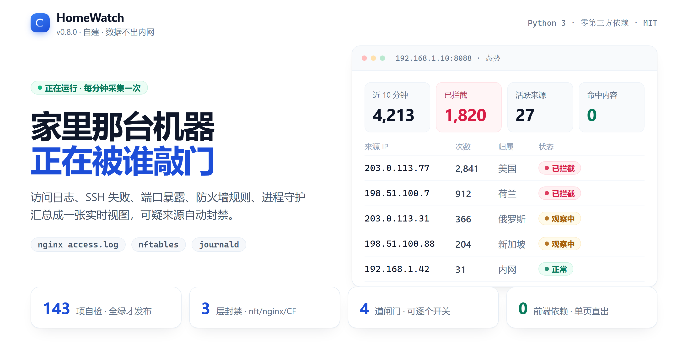
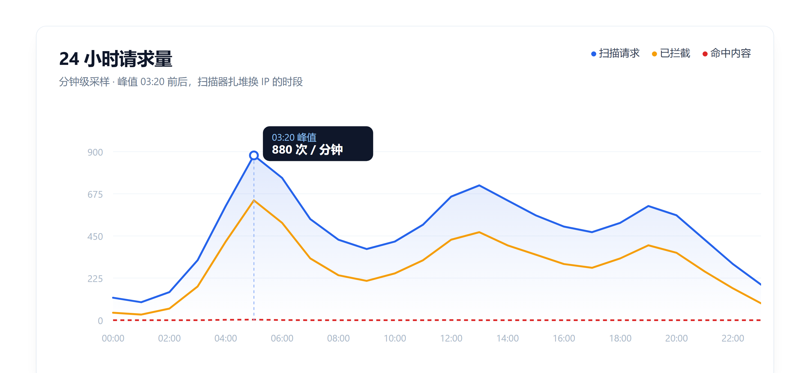
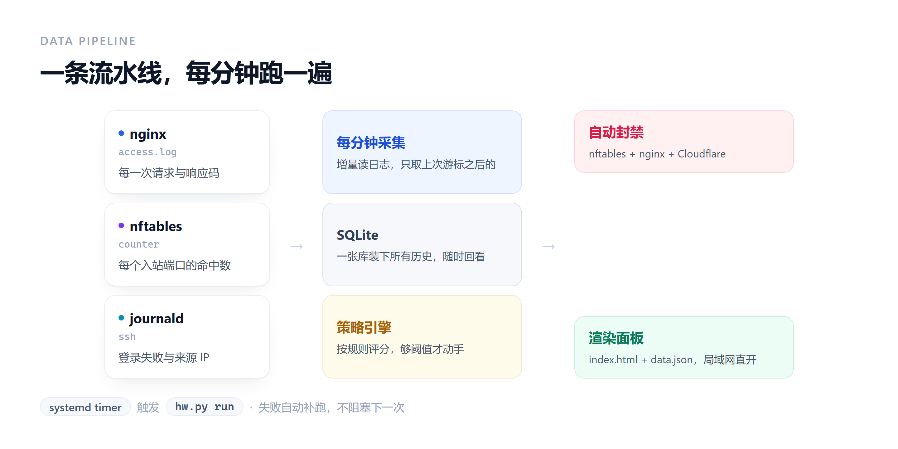
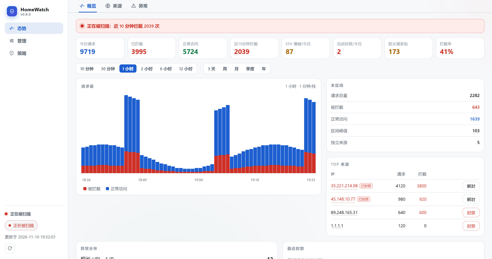
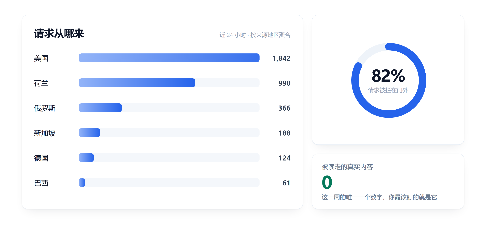
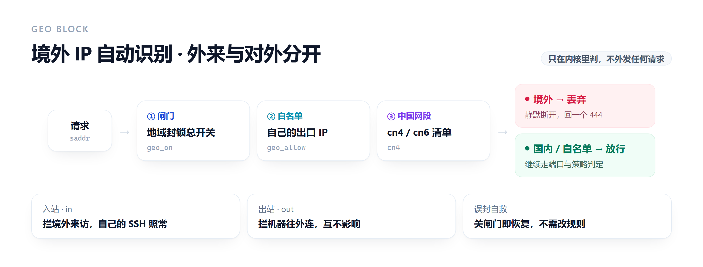
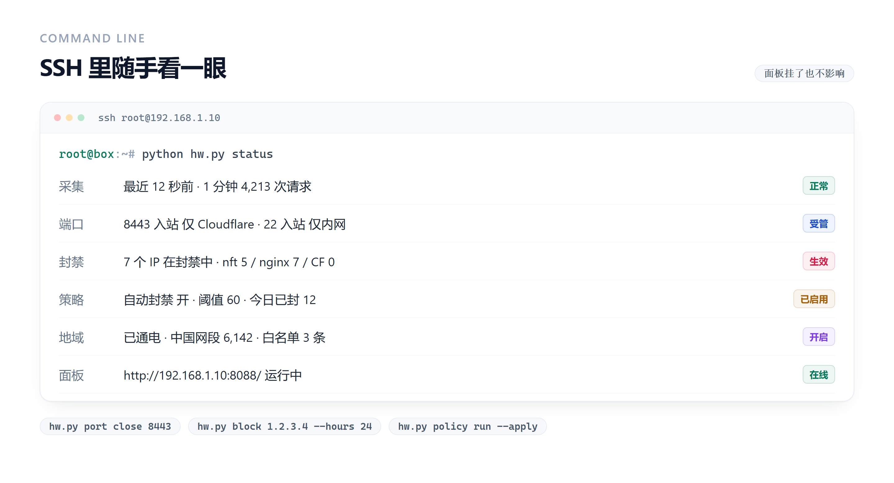

# HomeWatch

<div align="center">

**[▶ 在线说明页](https://airoy2277.github.io/homewatch/)** ｜ [快速开始](#快速开始) ｜ [部署手册](docs/ops.md) ｜ [版本记录](CHANGELOG.md) ｜ [MIT](LICENSE)

[](https://airoy2277.github.io/homewatch/)

</div>

---

家里那台机器挂在公网上的入口，被扫了多少、被谁扫、有没有真的被读走东西 —— 一个页面看完。

平时只读；需要处置时在页面上点一下，就能关端口、关 SSH、封 IP。可疑来源由策略引擎每分钟自动评估，够阈值才动手——默认静默封禁，回 `444` 直接断开，扫描器什么都拿不到；愿意的话还能一键推到 Cloudflare 边缘。

## 一分钟看懂



三条线就够了：蓝色是一直在被扫，橙色是被挡在门外，**红色虚线是真的被读走了东西**。红色长期贴地，就是你要的状态。

## 它是怎么跑的



三个来源每分钟读一次 → SQLite → 策略引擎评分 → 够阈值就封。封禁落到三层：`nftables` 丢包、`nginx` 回 444、Cloudflare 边缘拦截，可分别开关。

## 面板长什么样



打开就是一个只读的态势页。每个 IP 出现的地方都带封禁状态，也能就地一键封；右侧是自己的端口与策略，改完即刻生效。

## 请求从哪来



归属地由本机离线库补全，不外发任何查询。同一批人换个 IP 回来时，能一眼认出是哪些地区在反复试。

## 境外 IP



判断全在 `nftables` 里做：闸门 → 自己的白名单 → 中国网段，命中就丢，不经过任何在线接口。入站与出站分开开关，误封时关闸门即恢复，不用改规则。

## 命令行



面板挂了、或者懒得开浏览器时用的自救通道，和面板走同一套代码。

## 快速开始

### 本地跑（不碰系统目录）

```bash
cd /path/to/homewatch
python hw.py doctor                      # 环境自检
python hw.py -c config.example.json run  # 采集 + 渲染
python hw.py status                      # 命令行看状态
```

调试时用 `HOMEWATCH_ROOT` 把路径全重定向到沙箱，避免写 `/var/lib`：

```bash
HOMEWATCH_ROOT=./.test python hw.py -c config.example.json run
# 数据库 → ./.test/hw.db   面板 → ./.test/www/
```

### 部署到服务器

```bash
pip install paramiko
export HOMEWATCH_HOST=192.168.1.10                  # 服务器的内网地址（也可写进 .env）
SSH_PW='你的密码' python deploy/deploy.py push      # 只更新代码并试跑
SSH_PW='你的密码' python deploy/deploy.py install   # 首次安装 / 大版本升级
```

`install` 会做五件事：装采集定时器和管理服务、生成面板登录凭据、更新 nginx 站点、把 nftables 升级成集合结构（带 4 分钟自动回滚保险丝）。

首次安装会打印一次管理员密码（只打印这一次）：

```text
  用户名：admin
  密码：  xxxxxxxxxxxxxxxxxxxx
```

也可以自己指定 `HOMEWATCH_ADMIN_PASSWORD='你的密码' ... install`；事后要改，在面板「管理 → 面板登录」里改，或者 `hw.py auth passwd`，不用重装。

`push` 只覆盖代码，**不会动线上的 `config.json`**。改配置直接编辑服务器上的 `/opt/homewatch/config.json`，下一次 timer 触发即生效，不需要重启。

## 再往下看

细节都在折叠里，需要的时候展开；部署与故障处置在 [docs/ops.md](docs/ops.md)。

<details>
<summary><b>完整命令表</b> —— 采集、端口、服务、SSH、封禁、策略</summary>

### 命令

**采集类**

| 命令 | 作用 |
|---|---|
| `collect` | 只采集入库 |
| `render` | 只按库里的数据重新生成面板 |
| `run` | 采集 + 渲染（systemd timer 每分钟调用这个） |
| `status` | 命令行输出当前状态，适合 SSH 里随手看一眼 |
| `doctor` | 把日志、nft、journald、数据库、输出目录挨个检查一遍 |

**管理类**（面板挂掉时的自救通道，和面板走同一套代码）

| 命令 | 作用 |
|---|---|
| `port list` | 列出受管端口、入站/出站类型与协议 |
| `port close 8443` / `port open 8443` | 关闭 / 开放端口（等价于入站改成「禁止」/「全部放行」） |
| `port ctrl 8443 --dir in --mode cf` | 直接设入站类型：`allow` 放行 / `lan` 仅内网 / `cf` 仅 Cloudflare / `deny` 禁止 |
| `port ctrl 7000 --dir out --mode lan` | 设出站类型：`allow` / `lan` / `deny` |
| `port ctrl 8443 --dir in --mode lan --proto both` | 顺带改协议（`tcp` / `udp` / `both`） |
| `svc status` | 看采集定时器、管理接口、nginx 的运行状态与重启次数 |
| `svc guard on` / `svc guard off` | 开关进程守护（崩溃 3 秒后自动拉起） |
| `svc start\|stop\|restart homewatch-admin.service` | 启停单个单元（白名单内，含自我重启延后 2 秒） |
| `svc heal` | 一键修复：补齐开机自启并把没跑起来的拉起来 |
| `ssh status` / `ssh on` / `ssh off` | SSH 状态与开关 |
| `ssh port 2222` | 换 SSH 端口（15 分钟内不确认自动回滚） |
| `ssh port-confirm` / `ssh port-rollback` | 确认保留新端口 / 立刻改回旧端口 |
| `ssh passwd` | 改 root 密码（交互输入，不走命令行参数） |
| `auth status` | 面板登录密码：文件位置、用户名、上次修改时间、权限告警 |
| `auth passwd` | 改面板登录密码（`printf '新密码\n' \| hw.py auth passwd --stdin` 可脚本化） |
| `block 1.2.3.4 --hours 24` | 封禁 IP（默认 nginx + nft 两层都封） |
| `unblock 1.2.3.4` | 解封 |
| `policy status` | 看策略开关、规则表、上次评估结果、最近封禁 |
| `policy run` | 立即评估一次（默认只演练，加 `--apply` 才真封） |
| `policy auto on\|off` | 开关自动封禁 |
| `policy dry on\|off` | 开关演练模式（只记录不封） |
| `policy whitelist add\|remove 1.2.3.4` | 维护自动封禁白名单 |
| `policy limit uri_len 2048` | 改异常判定线（`uri_len` / `req_bytes` / `ua_len`） |
| `policy bot add\|remove Googlebot` | 维护不会被频率规则误封的爬虫名单 |
| `policy mode [visible\|silent\|silent_nolog]` | 看/切换封禁响应方式（会同步改站点配置） |
| `cf status` / `cf test` | Cloudflare 配置形态 / 校验 token |
| `cf rules` | 列出边缘现有 IP 规则 |
| `cf sync` | 把本地封禁全量对账到边缘 |
| `cf block\|unblock 1.2.3.4` | 只在边缘封 / 解 |
| `cf purge` | 清 Cloudflare 全站缓存 |
| `geo` | 看请求量靠前 IP 的归属地 |
| `geo lookup 1.2.3.4` | 查单个 IP（强制刷新缓存） |
| `geo refresh` | 重新补全最近 IP 的归属地 |
| `geo status` | 地域封锁状态：两个方向、作用端口、网段数、豁免清单、命中量 |
| `geo lock in --on [--scope web\|all]` | 开启外来封锁（境外访问本机）。`--scope web` 只挡 Web 端口且永远不含 SSH，`all` 含 SSH |
| `geo lock out --on` | 开启对外封锁（本机主动连境外，已建立的连接和 DNS 放行） |
| `geo unlock` | 关掉外来封锁；`geo unlock out` 关掉对外 |
| `geo allow 1.2.3.4` / `geo deny 1.2.3.4` | 往豁免清单里加 / 删一个地址（最多 64 条） |
| `geo cn-refresh` / `geo cn-list` | 立刻重拉国内网段 / 打印清单 |
| `geo nft` | 只打印地域拦截渲染出来的判定规则 |
| `firewall show` | 打印当前 nftables 规则 |
| `firewall refresh-cf` | 刷新 Cloudflare 回源网段 |
| `firewall init` | 把旧规则集升级成集合结构（首次用） |
| `fw list` | 列出防火墙规则表（方向 / 动作 / 协议 / 端口 / 来源 / 命中） |
| `fw add --name 面板白名单 --dir in --proto tcp --port 8088 --src 192.168.1.0/24` | 新增规则（`--action` 默认 `accept`，可给 `drop`；`--src` 多个用逗号） |
| `fw edit <id> --port 22 --action drop` | 改某条规则（只传要改的字段） |
| `fw del <id>` | 删除规则 |
| `fw on <id>` / `fw off <id>` | 启用 / 停用（停用即从 nft 里撤掉，但保留配置） |
| `fw up <id>` / `fw down <id>` | 调整匹配顺序 |
| `fw policy in drop` | 设默认策略（切 `drop` 前必须已有放行面板端口的白名单规则） |
| `fw container on\|off` | 是否把入站拒绝规则镜像到 `fw_fwd`（Docker 端口走 forward 链） |
| `fw seed` | 按「端口」页的出入站类型批量生成放行规则（已存在的跳过） |
| `fw nft` | 只打印规则表渲染出来的 nft 文本，不落地 |

不带子命令等价于 `run`。

</details>

<details>
<summary><b>管理功能</b> —— 面板上能做的每一件事</summary>

### 管理功能

左侧导航分三块：**态势**（看数据）、**管理**（端口 / 防火墙 / 服务 / 封禁 / 边缘 / 系统）、
**策略**（自动封禁规则）。窄屏时导航落到页面底部，键盘 `1` `2` `3` 可以直接切页，
地址栏的 `#mon` `#adm` `#adm.fw` 可分享、可前进后退（`.fw` `.svc` 这类后缀直接落到子页）。

态势的三个视图（概览 / 来源 / 异常）共用一条时间轴，10 分钟到一年共 11 档，
切换只在本地复用同一份 `/api/range` 结果，不会重发请求。
页面上任何 IP 都是可点的：点开是右侧抽屉（窄屏从底部上推），
里面有这个 IP 的请求曲线、访问路径、状态码、UA、敏感路径命中、封禁流水，
底部直接封禁 / 加白名单，不用跳到别的页面。
异常视图里每类异常下面直接铺出 top 3 来源 IP，点「全部 N 个来源」看完整名单和各自打过的路径。

| 功能 | 实现方式 | 生效速度 |
|---|---|---|
| **端口出入站** | 每个端口一组规则：入站 `放行 / 仅内网 / 仅 CF / 禁止`，出站 `放行 / 仅内网 / 禁止`，协议可选 TCP、UDP、TCP+UDP；改类型会整体重建 table（`nft -f` 单事务，不存在空窗） | 立即 |
| **端口开关** | 入站设为「禁止」等价于全量丢弃，`denied_ports` 集合同步保留做兼容 | 立即 |
| **防火墙规则表** | 云厂商那种有序规则表：方向 / 协议 / 端口或范围 / 来源白名单 / 放行或拒绝，增删改查 + 上下移 + 单条停用，另有默认策略和「应用到容器转发」；规则落 `fw_in` `fw_out` `fw_fwd` 三条子链，改完整表重建 | 立即 |
| **进程守护** | `homewatch-admin.service` 的 drop-in 写 `Restart=always` + `RestartSec=3`，开关即写即生效；重启自己时延后 2 秒，避免响应被 systemd 吃掉 | 立即 |
| **SSH 开关** | `systemctl disable/stop ssh.socket`，同时停 socket 和 service | 立即 |
| **SSH 换端口** | `ssh.socket` drop-in + `sshd_config` + nft 放行规则一起改，带 15 分钟自动回滚 | 立即 |
| **改 root 密码** | `chpasswd`，密码走 stdin | 立即 |
| **改面板密码** | 重写 htpasswd 里 admin 那一行（SHA-512 crypt），保留属主/权限，改前留 `.hw.bak` | 立即 |
| **地域封锁** | 国家级 CIDR 清单做 nft 集合查找，外来 / 对外两个方向各一把开关；豁免清单自动含内网、我的 IP、CF 回源、DNS | 立即（约 0.2 秒） |
| **IP 封禁** | nginx map（应用层）+ nft `blocked_ips`（网络层） | 立即 |
| **自动封禁** | 规则引擎每分钟评估，命中后批量下发两层 | 一分钟内 |
| **策略配置** | 面板改阈值/时长/白名单，写回 `config.json` | 下一次采集 |

#### 为什么 IP 封禁要写两层

走 Cloudflare 进来的流量，nft 看到的源地址是 **CF 的 IP**，不是攻击者的，
所以在网络层封攻击者 IP 对这条路完全无效。

nginx 里配了 `realip`，`$remote_addr` 已被还原成真实客户端 IP，在这里封才对 CF 流量生效。

所以默认两层都写：nginx 管应用层，nft 管直连和 SSH。

页面上凡是出现 IP 的地方都会先问一遍封禁状态（`/api/bans` 返回 nft / nginx /
Cloudflare 三层的合并结果）：已经封了的挂一个「已封禁」小标，没封的旁边就是
「封禁」按钮，点一下三层一起封，再点一次解封。

#### 地域封锁为什么不查归属地

逐 IP 查归属地要联网、要缓存、要等接口，几万个连接的场景根本跟不上；
nft 里一个集合查找就能判定，代价是一次哈希。所以用国家级 CIDR 清单
（IPv4 4000 多段、IPv6 1600 多段），刷新时合并相邻网段，落盘成
`geo_cn.json`，渲染规则时纯读文件不联网。

外来方向的作用范围默认是「只挡 Web 端口」，而且是按**端口**挡、**永不包含 SSH**——
远程管理不能因为开了个开关就失联。真要"任何形式都进不来"再选「所有端口」。
对外方向则是本机主动连境外，先放行 `ct state established,related` 再丢，
否则回给境外访客的响应包会被自己丢掉；DNS 服务器会自动进豁免清单。

6000 多个网段塞不进一次 `nft -f`（内核 netlink 批处理约 64KB，超了直接
`Message too long`），所以规则文件里只建空集合，网段由采集进程分批
`add element`（每批 900 段），灌完再往闸门集合里塞 `0.0.0.0/0` 让规则一次性通电。
闸门空着时规则不匹配任何包，所以中途失败最坏是"封锁没生效"，不会锁死自己。

</details>

<details>
<summary><b>安全策略与自动封禁</b> —— 规则表、评分、回包、Cloudflare 边缘</summary>

### 安全策略与自动封禁

每分钟采集完就顺手跑一次策略评估：从聚合数据里找可疑 IP，过一遍保护名单，
按规则自动封禁。**不需要手工盯着面板**。

#### 内置规则

| 规则 | 数据来源 | 默认条件 | 时长 | 下发层 |
|---|---|---|---|---|
| 蜜罐路径 | `/.git`、`/wp-login.php`、`/actuator/env` 等 | 1 小时内 ≥ 1 次 | 72h | 两层 |
| 超大请求被拒 | nginx 直接回的 413/414/431 | 10 分钟内 ≥ 1 次 | 24h | 两层 |
| 敏感文件探测 | 命中 `.env`/`.git`/`aws` 等路径 | 1 小时内 ≥ 3 个不同路径 | 48h | 两层 |
| SSH 爆破 | journald 失败登录 | 10 分钟内 ≥ 10 次 | 24h | nft |
| 单 IP 高频请求 | 该 IP 的全部请求数 | 2 分钟内 ≥ 120 次 | 12h | 两层 |
| 拦截洪水 | nginx 里 402/403 的请求 | 5 分钟内 ≥ 120 次 | 6h | 两层 |
| 错误响应洪水 | 4xx/5xx（不含已拦截的 402） | 5 分钟内 ≥ 200 次 | 6h | 两层 |
| 路径爬取 | 访问过的不重复路径数 | 5 分钟内 ≥ 120 个 | 6h | 两层 |
| 超长 URL | URI 长度 ≥ `limits.uri_len` | 5 分钟内 ≥ 3 次 | 24h | 两层 |
| 超大请求报文 | `$request_length` ≥ `limits.req_bytes` | 5 分钟内 ≥ 2 次 | 24h | 两层 |
| 异常请求方法 | GET/POST/HEAD/OPTIONS 之外的 TRACE、PROPFIND… | 5 分钟内 ≥ 3 次 | 24h | 两层 |
| 恶意 User-Agent | 空 UA、超长 UA、sqlmap/nikto/nuclei 等指纹 | 10 分钟内 ≥ 5 次 | 12h | 两层 |
| 异常协议版本 | 非 HTTP/1.0、1.1、2 | 5 分钟内 ≥ 5 次 | 12h | 两层（默认停用） |

规则可以在面板「策略」页直接改窗口、阈值、时长、生效层，也可以停用某一条。
改完写回 `config.json`，下一分钟生效，不用重启。

几个需要知道的口径：

- **窗口按整分钟对齐**。数据是分钟级聚合的，不对齐的话 60 秒窗口会把跨越整点的
  那一分钟整段切掉，表现就是"明明打了很多请求却不够阈值"。所以默认用 120 秒看
  "每秒 1 个请求"这种量级。
- **超长和超大是两条独立的路**：`long_uri` 看请求行里的 URI 长度；`big_req` 看
  nginx 的 `$request_length`（请求行 + 头 + 体）。URI 长到 nginx 直接拒掉时
  （414），走的是 `http_reject`，不需要日志里有任何扩展字段。
- **`big_req` 需要日志格式里带 `$request_length`**，没配就永远不会命中，
  面板「策略」页会显示一条黄色提示。配法见 `docs/ops.md`。
- **阈值不是越小越好**。`bad_ua` 把"空 UA"也算进去了，如果你的局域网里有脚本
  定时请求自己的站点，先把它加进 `own_ips` 或白名单。

#### 五道保护，误封优先于漏封

自动封禁最怕封错人，所以每个候选 IP 都要先过这几关：

1. `own_ips` 里的地址——自己的出口 IP，封了等于自断；
2. `policy.whitelist` 白名单（支持单个 IP 和网段）；
3. `firewall.lan_cidrs` 内网段；
4. Cloudflare 回源段——出现说明 realip 没生效，封了会把整个站点打死；
5. 已在封禁名单里的不重复写。

再加三道刹车：单次评估最多封 `max_bans_per_run`（默认 3）个；
同一 IP 在 `repeat_window_hours` 内再次触发，时长翻倍（上限 `max_hours`）；
命中多条规则时按置信度排序（蜜罐 > 超大被拒 > 敏感路径 > … > 高频请求），
保证"1 次蜜罐"不会被"60 次高频"挤出单次上限。

还有一条例外：UA 命中 `policy.trusted_bots` 的 IP（Googlebot、Bingbot、
UptimeRobot 等）不会被**频率类**规则封禁——爬虫抓得快点不该算 CC 攻击。
它要是去翻 `.git` 或者发超大报文，照样封。UA 本身可以伪造，所以这只是
"别误伤真爬虫"的便利，不是安全边界。

#### 先演练再开火

```bash
python3 hw.py policy dry on     # 只记录"本来会封谁"，不下发
python3 hw.py policy run        # 看一轮结果，确认没有误判
python3 hw.py policy dry off    # 确认没问题再真正开火
```

面板「策略」页的「演练一次」按钮等价于 `policy run`，不会改任何规则。

#### 一次评估做了什么

```
hits / paths / sshfail ──规则匹配──▶ 候选 IP ──保护名单──▶ 可封列表
                                                        │
                     nftables blocked_ips ◀──批量下发──┤
                     nginx 00-blocklist   ◀────────────┘
                                                        │
                               bans 表（流水）+ audit.log（一条汇总）
```

批量下发是有意为之：一次封 3 个只会 reload 一次 nginx、同步一次 nft 集合，
不会出现"封到一半规则集被刷三遍"的中间态。

#### 封禁怎么回包

被封的 IP 到底看到什么，是可配的（`policy.ban_mode`）：

| 模式 | 回什么 | 日志 | 适合 |
|---|---|---|---|
| `visible` | `402` + 一句文案 | 写 | 需要证据、需要统计被拦次数 |
| `silent`（默认） | `444`，不回任何字节直接断开 | 写 | 日常；扫描器只能看到超时 |
| `silent_nolog` | 同上 | **不写** | 被打得很凶、不想让日志继续涨 |

`444` 和"不写日志"都没法只靠 `conf.d` 里的 `map` 做到 —— `map` 只能产出变量，
真正回包和写日志的地方在站点配置里。所以切模式时 HomeWatch 会做一次受控的站点改写：

```nginx
# 改之前
access_log /var/log/nginx/home.log combined;
if ($blocked_scanner) { return 402; }

# 改之后
access_log /var/log/nginx/home.log combined if=$blocked_loggable;
if ($blocked_scanner) { return 444; }
```

只动**引用了 `$blocked_scanner` 的那一个 server 块**，改完统一 `nginx -t`，
不通过就把所有文件还原成改之前的内容。`$blocked_loggable` 的取值写在
`00-blocklist.conf` 的第二个 map 里，所以"记不记日志"以后只是改配置，不用再碰站点。

面板「管理 → 封禁 IP → 封禁响应」，或命令行：

```bash
hw.py policy mode                    # 看当前模式和接线状态
hw.py policy mode silent             # 切到 444
hw.py policy mode silent_nolog       # 444 且不写日志
hw.py policy mode visible            # 退回 402
```

站点的接线状态会出现在面板提示、`policy status` 和每次评估的 warnings 里：
状态码对不上时会直接告诉你"站点还在返回 402"。

#### 推到 Cloudflare 边缘

本地封禁解决的是"请求到了我怎么回"；推到边缘解决的是"请求根本别来"。

```
攻击者 ──▶ Cloudflare 边缘（IP Access Rules: block）──▶ 不会回源
                │
                └─ 未命中规则 ──▶ 源站 nginx ──▶ 本地封禁
```

在面板「管理 → Cloudflare 边缘」填两项就能用：

1. **API Token**：Cloudflare 后台 → My Profile → API Tokens → 创建，
   权限给 `Zone` → `Firewall` → `Edit`（只给这一个 zone 就够）；
2. **域名**：`example.com`（填 Zone ID 也行）。

点「检测连接」会校验 token 并解析出 Zone；「同步封禁」把本地全部封禁 IP 推过去。
打开自动同步后，策略每次自动封禁都会顺手推一条，边缘和本地始终一致。

几个约束值得知道：

- 用的只是 **IP Access Rules**：一条 IP 一条规则，`mode=block`，备注带 `HomeWatch` 前缀；
- 删除时**只删带这个前缀且 IP 匹配的规则**，手工建的规则不会被误伤；
- 单轮最多推 20 个、总预算 20 秒 —— 这段代码跑在每分钟的采集循环里，CF 挂了不能把采集拖死；
- CF 请求失败**不影响本地封禁**，失败原因单独记在 `cf` 字段和面板上，不会污染"复发次数"。

```bash
hw.py cf status      # 配置形态 + 上次同步结果
hw.py cf test        # 校验 token（联网）
hw.py cf rules       # 看边缘现有规则
hw.py cf sync        # 全量对账一次
hw.py cf block 1.2.3.4
hw.py cf unblock 1.2.3.4
hw.py cf purge       # 清全站缓存
```

注意 token 会明文存在 `config.json` 里，所以保存时会把文件权限收到 `600`。

</details>

<details>
<summary><b>访问定位与四道闸门</b></summary>

### 访问定位

面板上的 IP 会带上国家/城市/运营商，另有一张「来源地区」分布图。

- 归属地只在**采集循环**里补，结果进 `geo` 表缓存 30 天，页面刷新不发网络请求；
- 每次最多补 `geo.max_per_run`（默认 20）个，优先补请求量最高的 IP；
- 私有地址本地判定为"内网"，不查也不缓存；
- 默认走 ipwho.is（https，支持中文）；也可以用 `provider: ipapi` 走 ip-api 批量接口，
  或配 `mmdb` 用本地 MaxMind 库（需要 `pip install maxminddb`）；
- **不想让 IP 外发**就把 `geo.provider` 设成 `offline`：只读已有缓存，不再联网查询。

### 四道闸门

写操作等于把 root 机器的控制权放到了网页上，所以限制是一层套一层的：

1. **网络**：面板只监听内网 IP，nft 限制 `192.168.1.0/24`，公网到不了；
2. **认证**：`/api/` 走 nginx basic auth，静态页面（只看不改）不需要密码；
3. **接口**：管理服务只监听 Unix socket（不占端口），只接受带 `X-Requested-With` 头的 JSON POST，跨站请求伪造不出来；
4. **动作**：白名单分发，没有执行任意命令的入口，每个参数都校验类型和范围；
   密码类字段在审计日志里一律写成 `***`。

每次写操作都记一条审计（时间、来源 IP、动作、参数、结果、耗时），在面板底部可查，
文件在 `/var/log/homewatch/audit.log`。

#### 几个防呆

- 封禁 `own_ips` 里的地址会被拒绝——那都是你自己，封了会失联；
- 关闭面板自身端口（8088）会在返回结果里额外警告；
- Cloudflare 网段为空时**拒绝生成防火墙规则**，否则 `!= @cf_ips4` 恒真，会把 8443 整个封死、站点立刻挂掉；
- 改 nginx 配置时校验失败自动回滚，不会把站点改坏；
- 首次升级 nftables 带 4 分钟自动回滚保险丝，万一 SSH 被锁自动恢复。
- 没有国内网段清单时**拒绝开启地域封锁**，否则 `!= @cn4` 恒真会把所有来源挡掉；
- 从面板开启外来封锁时，如果操作者本身就是境外 IP 且不在豁免清单里，
  直接报错并给出服务器上执行的命令，避免"点了开关自己也进不来"。

</details>

<details>
<summary><b>配置、数据结构与设计取舍</b></summary>

### 配置

默认读 `/opt/homewatch/config.json`，完整示例见 `config.example.json`。

| 键 | 说明 |
|---|---|
| `own_ips` | 自己的出口 IP / 内网地址。面板标"我的"，泄漏检测跳过，封禁时拒绝 |
| `red_threshold_10m` | 近 10 分钟拦截数 ≥ 此值 → 红（默认 50） |
| `yellow_threshold_10m` | ≥ 此值 → 黄（默认 1） |
| `blocked_status` | 算作"已拦截"的状态码，默认 `[402, 403, 444]` |
| `retention_days` | 明细保留天数，默认 30 |
| `ssh_unit` | journald 里的 ssh 单元名，Debian/Ubuntu 是 `ssh`，RHEL 系是 `sshd` |
| `admin_port` | 面板端口，关闭它时会给额外警告 |
| `watch_ports` | 要统计 nft 丢包的端口，键名会变成 `net` 表的 `<键>_drop` 列 |
| `managed_ports` | 面板上可以开关的端口列表，`readonly: true` 的只展示 |
| `firewall.lan_cidrs` | 内网网段，规则里 `allow: lan` 引用它 |
| `firewall.rules` | 入站规则，`allow` 取 `lan` / `cf` / `any` |
| `policy.enabled` / `auto_ban` / `dry_run` | 策略总开关 / 自动封禁 / 演练模式 |
| `policy.max_bans_per_run` | 单次评估最多封几个（默认 3） |
| `policy.max_hours` / `repeat_window_hours` | 时长上限 / 复发统计窗口 |
| `policy.whitelist` | 永不自动封禁的 IP 或网段 |
| `policy.ban_mode` | 封禁响应：`visible`(402) / `silent`(444) / `silent_nolog`(444 且不写日志) |
| `policy.silent_log` | `silent` 模式下是否仍写 access.log，默认 `true` |
| `policy.limits` | 异常判定线：`uri_len`（URI 字节）、`req_bytes`（请求总字节）、`ua_len`（UA 字符） |
| `policy.allowed_methods` | 允许的请求方法，其余计入 `bad_method` |
| `policy.trusted_bots` | UA 关键字名单，命中者不被频率类规则封禁 |
| `policy.rules` | 规则列表：`source` + `window` + `threshold` + `hours` + `layer` |
| `geo.enabled` / `provider` | 归属地开关；`auto` / `ipapi` / `mmdb` / `offline` |
| `geo.mmdb` / `max_per_run` / `ttl_days` | 本地库路径 / 每轮最多查几个 / 缓存天数 |
| `cloudflare.enabled` | 是否启用边缘同步 |
| `cloudflare.api_token` | Cloudflare API Token，需要 Zone → Firewall 的编辑权限 |
| `cloudflare.zone_name` / `zone_id` | 域名或 Zone ID，填一个就行（填域名会自动查 ID） |
| `cloudflare.auto_sync` | 策略自动封禁后是否顺手推一条边缘规则（默认开） |
| `cloudflare.note` | 规则备注前缀，删除时只删带这个前缀的规则 |
| `paths.*` | 日志、数据库、输出目录、审计、封禁名单、站点配置、面板密码文件的位置 |

### 数据结构

分钟级聚合，不存原始行。一天 2.7 万行日志，聚合后只有几百行。

| 表 | 内容 |
|---|---|
| `hits` | `(分钟, IP, 状态码) → 次数` |
| `paths` | `(分钟, IP, 路径, 状态码) → 次数 + 响应体大小` |
| `sshfail` | `(分钟, IP) → 失败次数` |
| `net` | 每分钟一条 nft 计数器快照 |
| `sshseen` | journal 游标去重表 |
| `geo` | IP 归属地缓存：国家、城市、运营商、ASN、更新时间 |
| `anomaly` | `(分钟, IP, 类型) → 次数 + 最大值`，类型含超长 URL / 超大报文 / 异常方法 / 异常协议 / 恶意 UA / 蜜罐 |
| `agent` | `(分钟, IP) → 最后一条 UA`，用于展示客户端和识别可信爬虫 |
| `bans` | 封禁流水：谁、多久、哪条规则、自动还是手动 |
| `meta` | 日志偏移、inode、增量时间戳、上次策略评估结果 |

### 三个设计决定（都是踩过坑才这么写的）

**1. 判断泄漏要比较响应体大小，不能只看状态码。**
本站对任意路径都回 `index.html`（SPA fallback），所以 `/.env` 也是 `200`。
把当日出现次数最多的响应体大小当作"首页指纹"，大小对得上就说明回的是首页，
不是泄露。否则每天都会误报几百条"敏感文件泄漏"。

**2. journalctl 的增量不能用 `-n N` 配游标。**
两者一起用时返回的是游标**之前**的一段滑动窗口，每次读到的都是不同的旧记录，
计数会一路虚涨（实测从 854 涨到 3,631）。正确做法：用时间戳定增量窗口，
再用 `__CURSOR` 做幂等去重。

**3. 日志增量靠 inode + 字节偏移。**
inode 变了或文件变短（logrotate / 手工 truncate）就从头读。没有换行结尾的半行
不入库，留到下一轮。

### 部署形态

- **采集**：systemd timer，每分钟一次，`Type=oneshot`，不常驻；
- **管理接口**：`homewatch-admin.service`，常驻但只监听 `/run/homewatch/admin.sock`，
  不占任何端口；
- **面板**：nginx 监听内网地址 `8088`，静态只读公开，`/api/` 走 basic auth 反代；
- **权限**：采集和写操作都需要 root（读 journald、改 nftables、改密码）；
- **暴露面**：只有 8088 一个端口，且只监听内网 IP。公网不可达。

### 目录

```
hw.py                       启动器（服务器上就是 /opt/homewatch/hw.py）
homewatch/
  cli.py                    命令行入口
  config.py                 配置加载与合并
  db.py                     SQLite 结构与游标
  utils.py                  时间解析、时间窗
  collectors/               只读采集
    nginx.py                访问日志增量采集
    nft.py                  nftables 丢包计数
    ssh.py                  journald 爆破记录
  report.py                 聚合成面板要的 JSON
  banmap.py                 封禁状态汇总（nft / nginx / Cloudflare 三层合成一张表）
  patterns.py               敏感路径特征库（报表和策略共用）
  policy.py                 安全策略引擎：规则匹配、保护名单、自动封禁
  cloudflare.py             Cloudflare 边缘规则（IP Access Rules + 清缓存）
  geo.py                    IP 归属地查询与缓存
  web/
    render.py               原子写入 data.json / index.html
    page.html               页面模板（态势 + 管理 + 策略）
  ops/                      唯一的写操作层
    state.py                运行时状态（端口、封禁、CF 网段、防火墙规则）
    nft.py                  规则生成与集合维护（含 fw_in/fw_out/fw_fwd 三条子链）
    fw.py                   有序防火墙规则表：归一化、防呆、渲染、命中计数
    geoblock.py             地域封锁：国内网段刷新、豁免合成、规则渲染、分批下发
    procs.py                监听端口与归属进程 / 容器（ss + docker ps）
    nginx.py                封禁名单读写 + 模式切换 + 站点接线
    sshd.py                 SSH 开关、改 root 密码
    units.py                systemd 单元状态、进程守护 drop-in
    htpasswd.py             面板登录密码（basic auth 凭据文件）
  ipinfo.py                 单个 IP 的访问档案（态势页抽屉）
  admin/                    管理接口
    server.py               Unix socket HTTP 服务
    actions.py              受控动作白名单
    overview.py             管理页的状态汇总
    audit.py                审计日志
deploy/
  deploy.py                 整包上传，支持 push / install / check
  homewatch.service/.timer  采集定时器
  homewatch-admin.service   管理接口常驻服务
  nginx-homewatch.conf      面板站点（含 /api/ 反代）
config.example.json         配置示例
CHANGELOG.md                版本记录（每版改了什么）
docs/ops.md                 运维与回滚手册
docs/index.html             项目说明页（GitHub Pages 从这里发布）
docs/assets/                README 用的截图
tools/e2e_check.py          后端自检（规则渲染、防呆、落盘回读，143 项）
tools/panel_check.js        前端自检（最小 DOM 桩跑一遍页面脚本）
tools/remote.py             在线执行一条命令（读 .env 的连接信息）
tools/mirror.py             把线上面板搬到本地端口，用于真实浏览器截图
```

### 下一步可以做的

- [ ] 告警：红状态时推送到邮箱 / 企业微信，同一次攻击只发一次
- [ ] 应急模式一键止血：关掉所有非必要端口 + 关 SSH，只留 CF 回源
- [ ] 历史对比：昨天同一时段 vs 今天，识别"比以前更凶"
- [x] 扫描器指纹：UA 指纹 + 蜜罐路径已接入策略（sqlmap / nuclei / acunetix / zgrab…）
- [ ] 网段级封禁：同一 /24 里多个 IP 同时扫描时整段封（现在只封单个 IP）
- [x] Cloudflare API 集成：拿到 token 后直接在 CF 边缘封 IP，真正省掉回源流量
- [x] 静默封禁：444 直接断开，可选不写日志
- [x] 防火墙规则表：有序规则 + 增删改查 + 默认策略 + 容器转发联动 + 命中计数
- [ ] 规则组 / 定时生效：按时间段自动切换白名单（例如只在家时才开面板）
- [ ] 导出：把某一天的数据导成 CSV / 报表

</details>

## 文档

| 文件 | 内容 |
|---|---|
| [docs/ops.md](docs/ops.md) | 部署手册：安装、升级、回滚、地域封锁、故障处置 |
| [CHANGELOG.md](CHANGELOG.md) | 每个版本改了什么 |
| [在线说明页](https://airoy2277.github.io/homewatch/) | 一页看完它长什么样 |
| [config.example.json](config.example.json) | 全部配置项与默认值 |

## 许可

MIT，见 [LICENSE](LICENSE)。
